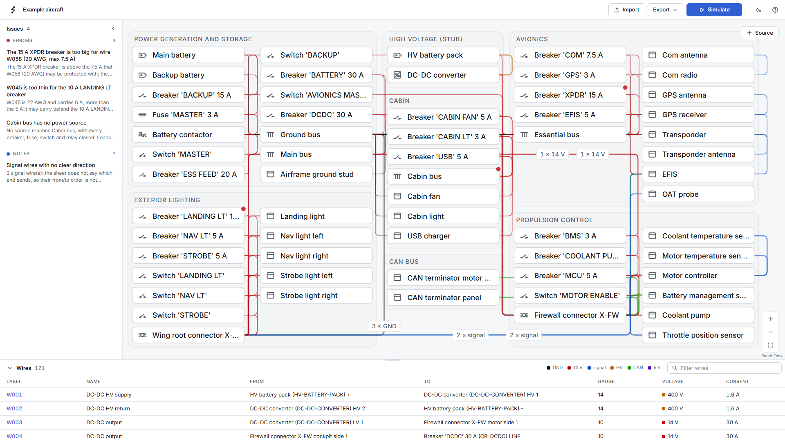
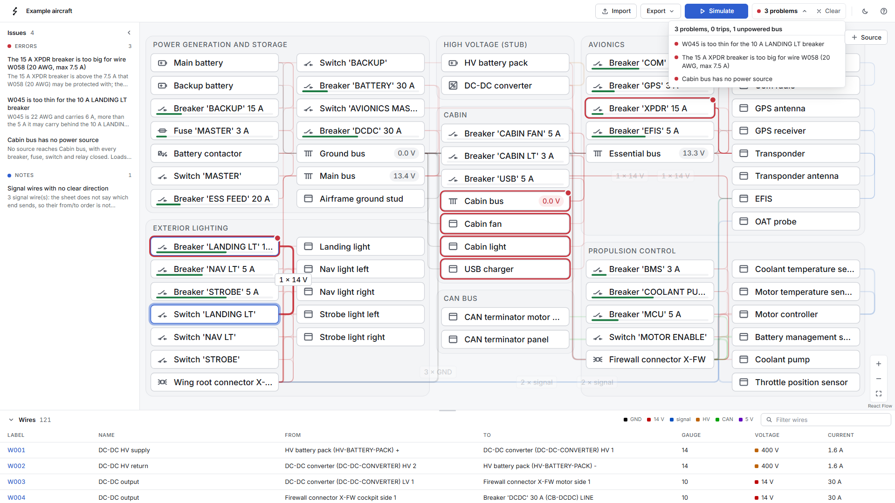
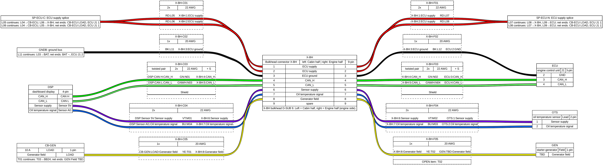

# schema-gen

Turns a wire list (one row = one physical conductor) into a map of the electrical system, checks, a DC simulation and
harness documentation. It is for people who build and rewire vehicles, aircraft and machines: anything with harness
connectors, splices, breakers and buses. You bring a wire list (a spreadsheet); schemagen shows the system as one
diagram, finds mistakes, and answers "does it work with the power on?" without a circuit-design tool.

## Status

- **1.0** is built, has had its product review and is merged into `main`. The fixes made after that review are on
  `dev/1.1` and not in `main` yet.
- **1.1** is in progress on branch `dev/1.1`. It is about real wiring drawings (see "What 1.1 is about"). The drawing
  engine is not built yet.
- The Python distribution is `schema-gen`; the import package and the command are `schemagen`. `pyproject.toml` says 1.0.0.

## What the app does today

Run it as a desktop window or in the browser (see "Install and run"). Everything is local: it listens on 127.0.0.1 only,
sends nothing anywhere, and bundles its assets.

- **Import** a wire list: drop an `.xlsx` or `.csv` on the window. A readable sheet (display names, connector and pin in
  one cell, see [docs/readable.md](docs/readable.md)) and the neutral table format both work. Cells it cannot read become
  findings, not exceptions. Without part data the sheet is simulated as "everything switched on" (D96).
- **The map**: one diagram of the whole system, components in power-flow order, grouped by zone, one line per pair of
  components. Zoom and pan; positions are remembered once you move a card.
- **Cards**: click a component to open its card: the issues on it first, then its pins and the wire on each. An Edit
  button reveals the fields; edits are saved as change sets (below). Wires have cards too.
- **Issues**: the rules (below) as sentences, grouped by cause. Click one to find it on the map.
- **Simulate**: one button runs the DC simulation and draws the result on the cards: bus voltages, how loaded each
  breaker and wire is, loads that stay dark and why. A wire thinner than its breaker allows, a breaker too big for its
  wire, and a bus with loads but no source are called out.
- **+ Source**: click a bus and add a battery to it to try a fix. This is a change set; the sheet is not touched.
- **Wires**: a drawer with every row of the sheet; click a row to see the wire on the map.
- **Export**: the project as a workbook or JSON, a printable wiring checklist (one table per component with tick
  boxes), and harness drawings (needs Graphviz and the optional `wireviz` extra, see below).
- **Quickstart tour**: eight steps on the fictional example (`examples/aircraft`, the Kestrel E2, 121 wires, three
  deliberate mistakes). Skippable and replayable from the Help menu. See [docs/tour.md](docs/tour.md).
- **Edits are change sets** (`changes/*.json`): applied on every load, undoable, never silent rewrites of your input files.





These screenshots show 1.0. In 1.1 the component card shows a drawing instead of the pin table, and the map labels lines
with wire counts.

## What 1.1 is about

This is a plan, not something that is done. Decision D106 in [docs/decisions.md](docs/decisions.md) sets the direction.

- **The map** stays one picture of the system. Exact wiring moves into drawings inside the card of a component, of a
  connection (a line on the map) and later of a harness connector or a selection.
- **A wiring-diagram engine of our own** in `schemagen/drawing/`: real aircraft-style wiring diagrams on A3 and A4 sheets
  with a title block. One Python engine produces a geometry JSON; the app renders it as SVG and exports SVG and PDF.
  The drawings must be good enough to rewire from, so the scope (component, connection, harness, selection) is an
  input of the engine from the start.
- **WireViz is an optional extra** (`pip install "schema-gen[wireviz]"`; done). `schemagen draw` and the harness-drawings
  export use it; the default install and the installer contain no GPL code. The cut list and continuity list move into the checklist export first.
- **Accuracy** is checked by a netlist round trip: the netlist read back from the geometry must equal the project's.
- **Order**: a symbol sheet and six reference drawings first, then a review stop, then integration into the app.

Already on `dev/1.1` (commit `0113927`): the map counts wires per line ("6 wires"), hovering a card lights its power
circuit, the component card shows a first drawing of each pin's run (`GET /api/drawing/{id}`, in
`schemagen/app/drawing.py`; not the engine above), a connection card opens for a line with several wires, and
"Save as PDF" prints a title-block sheet. The Playwright suite and the print path in the desktop window are not yet
verified for these changes.

## Install and run

```bash
pip install -e ".[dev]"              # from a checkout; the command is `schemagen`
schemagen app                        # the start screen; or: schemagen app examples/aircraft
schemagen app examples/demo --no-browser   # serve only, open http://127.0.0.1:8765 yourself
pytest
```

- Harness drawings (`schemagen draw`, and the Export menu's drawings) need Graphviz's `dot` on the PATH
  (`sudo apt-get install graphviz`, or the Windows installer from graphviz.org) and the optional WireViz extra
  (`pip install "schema-gen[wireviz]"`). Everything else works without them.
- **Windows installer**: `packaging/build.ps1` builds `packaging/dist/schemagen-setup-<version>.exe`
  (pywebview window, PyInstaller, per-user Inno Setup installer, no admin rights). CI builds it for pushes to
  `dev/1.0*` and for `v*` tags ([.github/workflows/installer.yml](.github/workflows/installer.yml)). It is not
  code-signed, so SmartScreen shows "unknown publisher". The installer ships neither WireViz nor Graphviz (D72).
  User data goes to `%LOCALAPPDATA%\schemagen`.
- Frontend development: `cd frontend && npm ci && npm run dev` (proxies `/api` to a running `schemagen app`);
  `npm run build` writes `schemagen/app/static/`; `npx playwright test` runs the end-to-end tests.

Start with the [tutorial](docs/tutorial.md) for the CLI. See also [CHANGELOG.md](CHANGELOG.md),
[docs/ROADMAP.md](docs/ROADMAP.md), [docs/decisions.md](docs/decisions.md), [docs/api.md](docs/api.md) and
[docs/metrics.md](docs/metrics.md).

## Command line

The CLI predates the app and still works on its own. `schemagen draw examples/demo` writes `examples/demo/out/`.

| command | does |
|---|---|
| `schemagen draw <project> [X-BH ...] [--all] [--split none\|side\|function\|auto] [--no-render] [--no-interfaces]` | harness drawings (WireViz), interface drawings for every conductor no harness drawing reaches, coverage report, cut list, continuity / insulation test sheet, `index.html`; `--no-render` skips WireViz |
| `schemagen check <project> [--format text\|json\|sarif] [-o FILE] [--rule ID]` | the rules (severity, objects, fix hint); exits 1 on an error |
| `schemagen fix direction\|names <project> [--apply]` | a reviewable change set (JSON + diff); `direction` makes every wire follow the direction convention; `--apply` stores it in `changes/` |
| `schemagen pinout <project> [--page-breaks]` | pinout and reintegration checklist per component and harness connector (XLSX + HTML), spares included |
| `schemagen wirelist <project> -o wirelist.xlsx` | readable wire list with the project's display names |
| `schemagen template [<project>] -o sheet.xlsx` | the editable workbook with dropdowns (works after upload to Google Sheets) |
| `schemagen labels <project> --update` | label ledger: records labels in use, retires removed ones with a reason (`--retire`, `--reason`) |
| `schemagen diff <A> <B> [--project DIR] [--format text\|json\|html]` | added, removed and changed wires, pins, labels, protection, open items; A and B are folders or git revisions |
| `schemagen changes <project> [--undo]` | list or undo the stored change sets |
| `schemagen app [<project>] [--port 8765] [--host H] [--no-browser]` | the local app; without a project it opens the start screen |
| `schemagen sim <project> [scenario.yml ...] [--faults all] [--infer]` | DC operating point per scenario and the fault sweep; HTML + JSON report in `<out>/sim/`; exits 1 when an expectation fails |
| `schemagen export <project> -o wires.xlsx [--readable]` | the project in the neutral table format: `.xlsx` workbook, a folder of CSVs, `.csv` (wires only) or `.json` (the whole model); `--readable` writes the readable sheet layout |
| `schemagen schema [-o schemas]` | JSON Schemas of the model, the part library and issues |
| `schemagen synth --wires N --seed S -o DIR [--readable] [--clean]` | a synthetic (fictional) project for tests and benchmarks |
| `schemagen palette <project> [--json]` | function class → colour code and hex, for spreadsheets and schematic tools |

`<project>` is a `schemagen.yml` or the folder that holds it. The `draw` command produces:

- **Harness drawings** per harness connector, one bundle per far item, each wire labelled with its gauge
  (`RD:L05 · 22`), CAN pairs twisted and shielded. Wide harnesses are split by side or by function.
- **"Continues at"** notes: every wire that ends on a splice, bus, breaker or another harness gets a short next-hop
  note (`L05 → L04 (CB-ECU LOAD), L06 (X-BH 2) [1]`); the full continuation goes into a numbered footnote table and the cut list.
- **Cut list** (CSV) and a **continuity / insulation test sheet** (CSV) between reachable terminals only (splices are
  sleeved, so tests walk through them).
- **index.html**: all drawings in one offline page with a wire-label search.



## A project

A project is a folder with a `schemagen.yml` and a wire list. The wire list stays in your own (private) repository;
this repository only holds the tool and a fictional demo. The wire list is either a **table** or **Python row modules**:

```
my-project/
  schemagen.yml
  wires.csv            # a table: CSV, XLSX or JSON, one row per conductor (set `source` in schemagen.yml)
  wirelist/            # ...or Python row modules:
    ss01_power.py      #   R = [dict(id=..., p1=..., p1c=..., p1p=..., p2=..., ..., func=..., bus=..., awg=...)]
    labels.json        #   optional: wire id -> printed label (L05)
    display.py         # optional (both forms): readable names; default in display_default.py
    names.py           # optional: NAMES (id -> wire name)
  cards/               # optional: datasheet interface cards (markdown) for real pin names
```

Row fields (the neutral format, `schemagen export` writes it): `id`, `label`, `name`, `p1`/`p1c`/`p1p` = from device /
connector / pin, `p2`/`p2c`/`p2p` = to, `func`, `bus`, `awg`, `amps`, `st` (status; `Open…` is flagged),
`subsystem`, `notes`. Device strings start with a code (`SP-…` splice, `CB-…` breaker, `GNDB` ground bus, `X-…`
harness connector); the prefixes are set in `schemagen.yml`.

The neutral table is lossless: every input key that has no column of its own is kept in the model's `extra` and gets
its own column on export (`key:json` when it holds lists or numbers). Row-module keys `src` (sources: `DOC p. 4; DOC2 p. 7`),
`zone`, `harn` (harness), `prot` (protective device) and `col` (explicit colour) map to model fields; module-level
`P` (protection), `D` (decisions) and `O` (open items) tables become objects. Plain column names (`from`, `from connector`,
`from pin`, `from side`, `gauge`, `current_A`, ...) and the 0.2 names (`p1`, `p1c`, ...) are both accepted.

Connector-half sides: give them in `schemagen.yml` (`sides: {X-BH: {Cabin half: near, Engine half: far}}`) or in the
table's `from side` / `to side` columns. `near_words` is only a fallback, and every guess is reported as a warning.

A *readable* wire list (display names, connector and pin merged into one text cell) is also accepted since 0.7: the
importer in `importers/readable.py` parses the cells into devices, connectors and pins, and cells it cannot parse become
findings (see [docs/readable.md](docs/readable.md)). The structured neutral table stays the lossless format.

`schemagen.yml` (all keys optional except what your data needs; see [examples/demo/schemagen.yml](examples/demo/schemagen.yml)):

| key | meaning |
|---|---|
| `wirelist`, `cards`, `out` | folders, relative to the yml |
| `source` | table input: `{path, sheet, header_row, columns: {field: column name}}` (see `table.py`) |
| `default_harnesses` | harness connectors drawn when none are named |
| `split`, `split_default`, `split_threshold` | per-harness split mode; `auto` splits by side above the threshold of far items (default 20) |
| `buses`, `bus_prefixes`, `breaker_prefixes`, `splice_prefix` | how device codes map to roles |
| `near_words` | words in a connector-half name that put it on the left (e.g. `cabin`, `half a`) |
| `colours` | function class → WireViz colour. Default: 14 V `RD`, 24 V `YE`, 5 V `VT`, GND `BK`, signal `BU`, CAN_H `GN`, CAN_L `GNWH`. Orange is not used: it is the usual HV colour. |
| `bus_class` | bus name → function class (e.g. `Switched out: 14 V`) |
| `label_class` | wire-label regex → function class, for powered wires whose bus name has no voltage (e.g. `'^T\d': 24 V`) |
| `harnesses` | for projects without `display.py`: `prefix: [name, code, far side]` |
| `cardmap` | fallback for cards without a structured block: `{device, connector, card, table}` regexes |

Optional `<out>/lengths.csv` (`label,length_m`) fills in lengths in the cut list, the bundles and the BOM.

### Datasheet cards

A card is a markdown file in `cards/`. schemagen reads a fenced block marked `yaml schemagen` anywhere in it:

````markdown
```yaml schemagen
device: '^ECU$'                 # regex on the device code in the wire list
connectors:
  - id: J1
    match: '^J1$'               # regex on the wire list's connector field
    part: TE 776286-1
    pins:
      - {n: 1, name: VBAT, type: power_in, v_max: 16, i_max: 5}
```
````

Cards without a block can still be used through `cardmap` (markdown pin tables), but that is fragile; ask whoever
writes the cards for the block.

## Rules

`schemagen check` runs every rule; each finding has an id, a severity, the objects it concerns
(`conductor:W12`, `pin:X-BH//3`, `component:ECU`, ...) and a fix hint. Switch a rule off or change its severity in
`schemagen.yml`: `rules: {duplicate-ends: off, contact-current: warning}`.

| rule | severity | checks |
|---|---|---|
| duplicate-id, duplicate-ends, label-duplicate, label-reused | error / warning | identity: ids, end pairs, printed labels, the label ledger |
| direction | warning | the wire direction convention (below) |
| gauge-protection | error | wire gauge vs breaker / fuse rating, FAA AC 43.13-1B Table 11-3 (`core/data/protection.yml`) |
| contact-gauge, contact-current, dsub-gauge | error | contact AWG range and current per contact from part data; D-sub crimp contacts 20–24 AWG |
| output-conflict, power-ground, required-pin | error / warning | pin types on a net: two outputs, power wired to ground, required pins left open |
| can-terminators, can-nodes, can-stub, can-part-data | error / warning / info | two terminations per bus, node count and stub length (SAE J1939-11, `core/data/can.yml`) |
| open-end, pin-clash, half-naming, side-guessed, gauge-change, class-change | error / warning | harness connector pins (ported from 0.2) |
| open-status, open-item, pin-tbd, gauge-tbd | info / warning | open items and fields still to be decided |

Every number from a standard is in `schemagen/core/data/*.yml` with its source, and overridable per project
(`tables: {protection: {breaker: {22: 5}}}`, `tables: {can: {max_stub_m: 0.3}}`).

**Wire direction convention** (`direction:` in schemagen.yml): supply runs source → load; returns run device → where
they return (ground bus, else the supplying unit's ground pin, else a splice); one-way signals run sender → receiver;
CAN runs in bus order from one terminator end, other bidirectional links from the controlling unit outward. Pin types
come from the part cards; breakers, switches and relays fall back to their terminal names (LINE / LOAD, IN / OUT,
COM / NO). `schemagen fix direction` swaps ends in a change set and never touches a label.

**Change sets** (`changes/*.json`) are applied on every load, in order. They are how the app and the fixes edit a
project whatever its source format; commit them like any other file.

## Simulation

`schemagen sim` builds a DC circuit from the model (modified nodal analysis, scipy sparse): every conductor is copper
resistance (Ω/m by AWG × length × temperature factor) plus contact resistance at each pin; breakers and fuses are
small resistances with a trip curve; switch and relay contacts are present when closed and relay coils close their
contacts at pick-up (iterated to a fixed point, oscillation reported). Sources and loads come from the part cards:

```yaml schemagen
kind: battery
source: {v_oc: 13.2, r_int: 0.02}            # DC/DC: {v_out, i_limit, r_out, efficiency}
load: {model: constant_power, p_w: 12, v_min: 9}   # or constant_current (i_a) or resistive (r_ohm)
trip_curve: [[1.15, 3600], [2, 12], [10, 0.02]]    # breakers / fuses: multiple of rating -> seconds
```

Lengths come from `lengths.csv` (measured), then the conductor's `length_m` (design), then zone-to-zone estimates
(`zones: {CB: {xy: [1.5, 0]}}`), then a default; every parameter is marked measured / datasheet / design / estimated /
assumed and every result lists the assumptions it rests on. Defaults and their sources: `schemagen/core/data/sim.yml`,
`wire.yml`; override them under `sim:` and `tables:` in schemagen.yml.

Scenarios are YAML files in `<project>/scenarios/` (`set` switch / relay / breaker / load states, `faults` short /
open / fail, `expect` `powered`, `max_drop_V`, `min_voltage`, `no_trip`); see `schemagen/sim/report.py`.
`--faults all` shorts every powered node to ground and reports the prospective current, the device that trips first
and when, wire survival (I²t, IEC 60364-4-43 k), the interrupt rating and selectivity. A design check, not certification evidence.

## The app's server

`schemagen app` starts a FastAPI server (127.0.0.1 only, no telemetry, assets bundled in the package) that serves the
React + TypeScript frontend from `schemagen/app/static/`. The desktop window (`schemagen/desktop.py`) wraps the same
server in a pywebview window. The endpoints the frontend uses are in [docs/api.md](docs/api.md). The endpoints of the
0.5 multi-page app (`/api/index`, `/api/object`, `/api/graph`, `/api/sim/*`, `/api/drawings*`, `/api/diff`) are still
served for tests and power users; the 1.0 frontend does not call them.

## Code map

| module | role |
|---|---|
| `core/model.py` | the typed model (Pydantic v2): conductors, components, connectors, parts, protection, decisions, open items, ledger; JSON Schemas in `schemas/` |
| `core/config.py` | `schemagen.yml` → `Config` |
| `core/load.py`, `core/build.py` | pick the importer, resolve labels / classes / sides, derive components and protection |
| `core/net.py` | typed connectivity (union-find); breakers and switches are elements, not connections |
| `importers/` | row modules, tables (XLSX / CSV / CSV folder / JSON), the readable sheet, WireViz YAML, part cards |
| `exporters/` | neutral table (workbook / CSV folder / CSV), JSON model, pinout, readable wire list, sheet template |
| `core/rules.py`, `core/context.py`, `core/direction.py` | rules engine, shared analysis (pin types, protection regions, CAN buses), direction convention |
| `core/changes.py`, `core/diff.py`, `core/ledger.py` | change sets, project diff (folders or git revisions), label ledger |
| `core/tables.py`, `core/data/` | cited reference tables (protection, copper, CAN, simulation defaults) |
| `renderers/` | interface drawings, the WireViz command runner (parallel batches) |
| `app/server.py`, `app/workspace.py`, `app/drawing.py`, `app/userdata.py`, `desktop.py`, `frontend/` | the local app: FastAPI server, the main screen and cards in one call, the card drawing (1.1, first version), per-user settings, the desktop window, and the React + TypeScript frontend (built into `app/static/`) |
| `packaging/` | Windows installer: PyInstaller spec, Inno Setup script, `build.ps1`, smoke test, third-party notices |
| `sim/overlay.py`, `core/fit.py` | the app's Simulate overlay (one status and reason per object); the one sentence for a wire that does not fit its protective device |
| `sim/engine.py`, `sim/build.py`, `sim/api.py`, `sim/report.py` | MNA solver (Newton, relays, current limits), model → circuit with provenance, operating point / expectations / fault sweep, report and CLI |
| `renderers/project.py`, `renderers/wirenet.py` | the loaded project as 0.2-style wire dicts and net queries, for the drawing code |
| `drawing.py`, `outputs.py`, `cards.py`, `project.py`, `net.py`, `palette.py`, `config.py`, `table.py`, `styles.py` | 0.2 import paths, kept as re-exports |
| `core/classes.py` | function class, wire colour, gauge |
| `importers/cards.py`, `importers/display.py` | pin names from card blocks (or markdown tables); default readable names |
| `renderers/harness.py`, `renderers/checks.py` | WireViz document for one harness connector or one part of it; its 0.2 checks |
| `exporters/documents.py`, `exporters/palette.py` | YAML, footnotes, cut list, test sheet, checks, index page; the palette |
| `cli/` | `schemagen` command (`cli/draw.py`, `cli/commands.py`) |

## Why WireViz 0.4.1 (and not Filare)

This is about the current `draw` command; WireViz is an optional extra, and 1.1 plans its own drawing engine (see above).
Short version: WireViz renders everything this needs; Filare 1.6.0 (its fork) drops notes on simple nodes and
wires without a length from the BOM, and does not install cleanly. Details in [docs/wireviz-evaluation.md](docs/wireviz-evaluation.md).
The generator emits plain WireViz YAML, so the renderer stays replaceable.

## Licence

MIT (see `LICENSE`). WireViz (GPL-3.0, the optional `wireviz` extra) is never imported by schemagen: it writes WireViz YAML and runs the separate
`wireviz` command (a test checks this). The Windows installer does not contain WireViz or Graphviz (D72).
