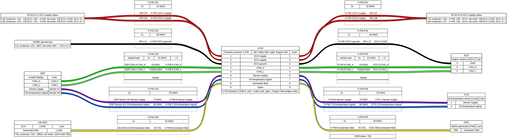

# schema-gen

Turns an aircraft wire list (one row = one physical conductor) into harness documentation, and later into a
simulation of the electrical system:

- **Harness drawings** per harness connector, rendered with [WireViz](https://github.com/wireviz/WireViz) (SVG, PNG, HTML + BOM).
- **"Continues at" notes**: every wire that ends on a splice, bus, breaker or another harness shows where it goes next
  and where its net finally ends, worked out over the whole wire list.
- **Cut list** (CSV): label, from, to, gauge, colour, length, continues-at.
- **Continuity / insulation test sheet** (CSV): per wire, end to end through the mated connector, and pin-to-pin
  insulation that knows which pins are tied on purpose by a splice.
- **Consistency checks**: pin clashes, one-sided pins, gauge or function changes across a connector, TBD pins and gauges.
- **index.html**: all drawings in one offline page, with a wire-label search that highlights the wire in the drawing.

Roadmap: a DC current-flow simulation on top of the same net model, so one tool can answer "does this load get power
with these switches, how much current flows in each wire, does any breaker trip?". See [docs/ROADMAP.md](docs/ROADMAP.md).



## Quick start

```bash
sudo apt-get install graphviz        # WireViz needs Graphviz's `dot`
pip install -e ".[dev]"
schemagen draw examples/demo         # writes examples/demo/out/
pytest
```

`schemagen draw <project> [X-FW X-WL ...] [--all] [--no-render]`, where `<project>` is a `schemagen.yml` or the folder that holds it.
`--no-render` writes the YAML, CSVs and checks without WireViz/Graphviz.

## A project

A project is a folder with a `schemagen.yml` and a wire list. The wire list stays in your own (private) repository;
this repository only holds the tool and a fictional demo.

```
my-aircraft/
  schemagen.yml
  wirelist/
    ss01_power.py      # row modules: R = [dict(id=..., p1=..., p1c=..., p1p=..., p2=..., ..., func=..., bus=..., awg=...)]
    ss02_....py        # optional: SUBSYSTEM, DISPLAY (raw device -> readable name), P (protection list)
    labels.json        # optional: wire id -> printed label (L05)
    display.py         # optional: readable names; without it schemagen uses its default (see display_default.py)
    names.py           # optional: NAMES (id -> wire name), T_IDS (24 V label series)
  cards/               # optional: datasheet interface cards (markdown pin tables) for real pin names
```

Row fields: `id`, `p1`/`p1c`/`p1p` = from device / connector / pin, `p2`/`p2c`/`p2p` = to, `func`, `bus`, `awg`,
`st` (status; `Open…` is flagged), optional `name`, `dom`. Device strings start with a code (`SP-…` splice,
`CB-…` breaker, `GNDB` ground bus, `X-…` harness connector); the prefixes are set in `schemagen.yml`.

`schemagen.yml` (all keys optional except what your data needs; see [examples/demo/schemagen.yml](examples/demo/schemagen.yml)):

| key | meaning |
|---|---|
| `wirelist`, `cards`, `out` | folders, relative to the yml |
| `default_harnesses` | harness connectors drawn when none are named |
| `buses`, `bus_prefixes`, `breaker_prefixes`, `splice_prefix` | how device codes map to roles |
| `near_words` | words in a connector-half name that put it on the left (e.g. `cockpit`, `half a`) |
| `colours` | function class → WireViz colour. Default: 14 V `RD`, 24 V `YE`, 5 V `VT`, GND `BK`, signal `BU`, CAN_H `GN`, CAN_L `GNWH`. Orange is not used: it is the HV colour. |
| `bus_class`, `domain_class` | extra rules for the function class (e.g. `Switched out: 14 V`) |
| `harnesses` | for projects without `display.py`: `prefix: [name, code, far side]` |
| `cardmap` | `{device, connector, card, table}` regexes that point a device connector at a card pin table |

Optional `<out>/lengths.csv` (`label,length_m`) fills in lengths in the cut list, the bundles and the BOM.

## Code map

| module | role |
|---|---|
| `config.py` | `schemagen.yml` → `Config` |
| `project.py` | loads the row modules; device roles and readable names |
| `styles.py` | function class and wire colour, gauge |
| `net.py` | connectivity over the whole wire list (union-find); the base for notes, tests and the simulation |
| `cards.py` | pin names from card pin tables |
| `drawing.py` | WireViz document for one harness connector |
| `checks.py` | consistency checks |
| `outputs.py` | YAML, render, cut list, test sheet, checks, index page |
| `cli.py` | `schemagen` command |

## Why WireViz 0.4.1 (and not Filare)

Short version: WireViz renders everything this needs; Filare 1.6.0 (its fork) drops notes on simple nodes and
wires without a length from the BOM, and does not install cleanly. Details in [docs/wireviz-evaluation.md](docs/wireviz-evaluation.md).
The generator emits plain WireViz YAML, so the renderer stays replaceable.

## Licence

MIT (see `LICENSE`). Note that WireViz itself is GPL-3.0; schemagen calls it as a separate, unmodified dependency.
