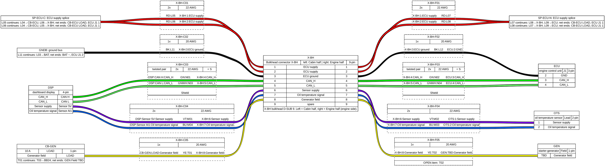

# schema-gen

Turns a wire list (one row = one physical conductor) into wiring-harness documentation, and later into a
simulation of the electrical system. Built for vehicles, aircraft and machines: anything with harness
connectors, splices, breakers and buses.

- **Harness drawings** per harness connector, rendered with [WireViz](https://github.com/wireviz/WireViz) (SVG, PNG,
  HTML + BOM). One bundle per far item, each wire labelled with its gauge (`RD:L05 · 22`), CAN pairs twisted and shielded.
  Wide harnesses are split by side or by function.
- **"Continues at"**: every wire that ends on a splice, bus, breaker or another harness gets a short next-hop note
  (`L05 → L04 (CB-ECU LOAD), L06 (X-BH 2) [1]`); the full continuation and net end points go into a numbered footnote
  table under the drawing and into the cut list.
- **Cut list** (CSV): label, from, to, bundle, gauge, colour, length, continues-at.
- **Continuity / insulation test sheet** (CSV) between reachable terminals only (splices are sleeved, so tests walk
  through them): each connector half to its equipment, end to end through the mated connector (parallel contacts
  flagged), and pin-to-pin insulation that knows which pins are tied on purpose.
- **Consistency checks**: pin clashes, one-sided pins, gauge or function changes across a connector, TBD pins and gauges.
- **index.html**: all drawings in one offline page; a wire-label search highlights the wire and its footnote.
- **Part data from datasheet cards**: pin names from a structured block in each card (the start of a part library).
- **One palette** for every output; other tools read it with `schemagen palette`.

Next: a neutral data model, then a DC current-flow simulation on the same net model ("does this load get power with
these switches, how much current flows in each wire, does this breaker protect this wire?"). See [docs/ROADMAP.md](docs/ROADMAP.md).



## Quick start

```bash
sudo apt-get install graphviz        # WireViz needs Graphviz's `dot`
pip install -e ".[dev]"
schemagen draw examples/demo         # writes examples/demo/out/
pytest
```

| command | does |
|---|---|
| `schemagen draw <project> [X-BH ...] [--all] [--split none\|side\|function\|auto] [--no-render] [--no-interfaces]` | harness drawings, interface drawings for every conductor no harness drawing reaches, coverage report, and their extras |
| `schemagen check <project> [--format text\|json\|sarif] [-o FILE]` | the rules (severity, objects, fix hint); exits 1 on an error |
| `schemagen fix direction <project> [--apply]` | a reviewable change set (JSON + diff) that makes every wire follow the direction convention; `--apply` stores it in `changes/` |
| `schemagen pinout <project>` | pinout per component and harness connector (XLSX + HTML), spares included |
| `schemagen wirelist <project> -o wirelist.xlsx` | readable wire list with the project's display names |
| `schemagen template [<project>] -o sheet.xlsx` | the editable workbook with dropdowns (works after upload to Google Sheets) |
| `schemagen labels <project> --update` | label ledger: records labels in use, retires removed ones with a reason |
| `schemagen diff <A> <B> [--project DIR] [--format text\|json\|html]` | added, removed and changed wires, pins, labels, protection, open items; A and B are folders or git revisions |
| `schemagen changes <project> [--undo]` | list or undo the stored change sets |
| `schemagen sim <project> [scenario.yml ...] [--faults all]` | DC operating point per scenario and the fault sweep; HTML + JSON report in `<out>/sim/`; exits 1 when an expectation fails |
| `schemagen export <project> -o wires.xlsx` | the project in the neutral table format: `.xlsx` workbook, a folder of CSVs, `.csv` (wires only) or `.json` (the whole model) |
| `schemagen schema [-o schemas]` | JSON Schemas of the model, the part library and issues |
| `schemagen synth --wires N --seed S -o DIR` | a synthetic (fictional) project for tests and benchmarks |
| `schemagen palette <project> [--json]` | function class → colour code and hex, for spreadsheets and schematic tools |

`<project>` is a `schemagen.yml` or the folder that holds it. `--no-render` writes YAML, CSVs and checks without WireViz.

## A project

A project is a folder with a `schemagen.yml` and a wire list. The wire list stays in your own (private) repository;
this repository only holds the tool and a fictional demo. The wire list is either a **table** or **Python row modules**:

```
my-project/
  schemagen.yml
  wires.csv            # a table: CSV, XLSX or JSON, one row per conductor (set `source` in schemagen.yml)
  wirelist/            # ...or Python row modules:
    ss01_power.py      #   R = [dict(id=..., p1=..., p1c=..., p1p=..., p2=..., ..., func=..., bus=..., awg=...)]
    labels.json        #   optional: wire id -> printed label (L05)
    display.py         # optional (both forms): readable names; default in display_default.py
    names.py           # optional: NAMES (id -> wire name)
  cards/               # optional: datasheet interface cards (markdown) for real pin names
```

Row fields (the neutral format, `schemagen export` writes it): `id`, `label`, `name`, `p1`/`p1c`/`p1p` = from device /
connector / pin, `p2`/`p2c`/`p2p` = to, `func`, `bus`, `awg`, `amps`, `st` (status; `Open…` is flagged),
`subsystem`, `notes`. Device strings start with a code (`SP-…` splice, `CB-…` breaker, `GNDB` ground bus, `X-…`
harness connector); the prefixes are set in `schemagen.yml`.

The neutral table is lossless: every input key that has no column of its own is kept in the model's `extra` and gets
its own column on export (`key:json` when it holds lists or numbers). Row-module keys `src` (sources: `DOC p. 4; DOC2 p. 7`),
`zone`, `harn` (harness), `prot` (protective device) and `col` (explicit colour) map to model fields; module-level
`P` (protection), `D` (decisions) and `O` (open items) tables become objects. Plain column names (`from`, `from connector`,
`from pin`, `from side`, `gauge`, `current_A`, ...) and the 0.2 names (`p1`, `p1c`, ...) are both accepted.

Connector-half sides: give them in `schemagen.yml` (`sides: {X-BH: {Cabin half: near, Engine half: far}}`) or in the
table's `from side` / `to side` columns. `near_words` is only a fallback, and every guess is reported as a warning.

A *readable* wire list (display names, connector and pin merged into one text cell) is a view, not a source: it has
lost the device codes and pin structure the net model needs. Export the structured rows instead.

`schemagen.yml` (all keys optional except what your data needs; see [examples/demo/schemagen.yml](examples/demo/schemagen.yml)):

| key | meaning |
|---|---|
| `wirelist`, `cards`, `out` | folders, relative to the yml |
| `source` | table input: `{path, sheet, header_row, columns: {field: column name}}` (see `table.py`) |
| `default_harnesses` | harness connectors drawn when none are named |
| `split`, `split_default`, `split_threshold` | per-harness split mode; `auto` splits by side above the threshold of far items (default 20) |
| `buses`, `bus_prefixes`, `breaker_prefixes`, `splice_prefix` | how device codes map to roles |
| `near_words` | words in a connector-half name that put it on the left (e.g. `cabin`, `half a`) |
| `colours` | function class → WireViz colour. Default: 14 V `RD`, 24 V `YE`, 5 V `VT`, GND `BK`, signal `BU`, CAN_H `GN`, CAN_L `GNWH`. Orange is not used: it is the usual HV colour. |
| `bus_class` | bus name → function class (e.g. `Switched out: 14 V`) |
| `label_class` | wire-label regex → function class, for powered wires whose bus name has no voltage (e.g. `'^T\d': 24 V`) |
| `harnesses` | for projects without `display.py`: `prefix: [name, code, far side]` |
| `cardmap` | fallback for cards without a structured block: `{device, connector, card, table}` regexes |

Optional `<out>/lengths.csv` (`label,length_m`) fills in lengths in the cut list, the bundles and the BOM.

### Datasheet cards

A card is a markdown file in `cards/`. schemagen reads a fenced block marked `yaml schemagen` anywhere in it:

````markdown
```yaml schemagen
device: '^ECU$'                 # regex on the device code in the wire list
connectors:
  - id: J1
    match: '^J1$'               # regex on the wire list's connector field
    part: TE 776286-1
    pins:
      - {n: 1, name: VBAT, type: power_in, v_max: 16, i_max: 5}
```
````

Cards without a block can still be used through `cardmap` (markdown pin tables), but that is fragile; ask whoever
writes the cards for the block.

## Rules

`schemagen check` runs every rule; each finding has an id, a severity, the objects it concerns
(`conductor:W12`, `pin:X-BH//3`, `component:ECU`, ...) and a fix hint. Switch a rule off or change its severity in
`schemagen.yml`: `rules: {duplicate-ends: off, contact-current: warning}`.

| rule | severity | checks |
|---|---|---|
| duplicate-id, duplicate-ends, label-duplicate, label-reused | error / warning | identity: ids, end pairs, printed labels, the label ledger |
| direction | warning | the wire direction convention (below) |
| gauge-protection | error | wire gauge vs breaker / fuse rating, FAA AC 43.13-1B Table 11-3 (`core/data/protection.yml`) |
| contact-gauge, contact-current, dsub-gauge | error | contact AWG range and current per contact from part data; D-sub crimp contacts 20–24 AWG |
| output-conflict, power-ground, required-pin | error / warning | pin types on a net: two outputs, power wired to ground, required pins left open |
| can-terminators, can-nodes, can-stub, can-part-data | error / warning / info | two terminations per bus, node count and stub length (SAE J1939-11, `core/data/can.yml`) |
| open-end, pin-clash, half-naming, side-guessed, gauge-change, class-change | error / warning | harness connector pins (ported from 0.2) |
| open-status, open-item, pin-tbd, gauge-tbd | info / warning | open items and fields still to be decided |

Every number from a standard is in `schemagen/core/data/*.yml` with its source, and overridable per project
(`tables: {protection: {breaker: {22: 5}}}`, `tables: {can: {max_stub_m: 0.3}}`).

**Wire direction convention** (`direction:` in schemagen.yml): supply runs source → load; returns run device → where
they return (ground bus, else the supplying unit's ground pin, else a splice); one-way signals run sender → receiver;
CAN runs in bus order from one terminator end, other bidirectional links from the controlling unit outward. Pin types
come from the part cards; breakers, switches and relays fall back to their terminal names (LINE / LOAD, IN / OUT,
COM / NO). `schemagen fix direction` swaps ends in a change set and never touches a label.

**Change sets** (`changes/*.json`) are applied on every load, in order. They are how the app and the fixes edit a
project whatever its source format; commit them like any other file.

## Simulation

`schemagen sim` builds a DC circuit from the model (modified nodal analysis, scipy sparse): every conductor is copper
resistance (Ω/m by AWG × length × temperature factor) plus contact resistance at each pin; breakers and fuses are
small resistances with a trip curve; switch and relay contacts are present when closed and relay coils close their
contacts at pick-up (iterated to a fixed point, oscillation reported). Sources and loads come from the part cards:

```yaml schemagen
kind: battery
source: {v_oc: 13.2, r_int: 0.02}            # DC/DC: {v_out, i_limit, r_out, efficiency}
load: {model: constant_power, p_w: 12, v_min: 9}   # or constant_current (i_a) or resistive (r_ohm)
trip_curve: [[1.15, 3600], [2, 12], [10, 0.02]]    # breakers / fuses: multiple of rating -> seconds
```

Lengths come from `lengths.csv` (measured), then the conductor's `length_m` (design), then zone-to-zone estimates
(`zones: {CB: {xy: [1.5, 0]}}`), then a default; every parameter is marked measured / datasheet / design / estimated /
assumed and every result lists the assumptions it rests on. Defaults and their sources: `schemagen/core/data/sim.yml`,
`wire.yml`; override them under `sim:` and `tables:` in schemagen.yml.

Scenarios are YAML files in `<project>/scenarios/` (`set` switch / relay / breaker / load states, `faults` short /
open / fail, `expect` `powered`, `max_drop_V`, `min_voltage`, `no_trip`); see `schemagen/sim/report.py`.
`--faults all` shorts every powered node to ground and reports the prospective current, the device that trips first
and when, wire survival (I²t, IEC 60364-4-43 k), the interrupt rating and selectivity. A design check, not certification evidence.

## Code map

| module | role |
|---|---|
| `core/model.py` | the typed model (Pydantic v2): conductors, components, connectors, parts, protection, decisions, open items, ledger; JSON Schemas in `schemas/` |
| `core/config.py` | `schemagen.yml` → `Config` |
| `core/load.py`, `core/build.py` | pick the importer, resolve labels / classes / sides, derive components and protection |
| `core/net.py` | typed connectivity (union-find); breakers and switches are elements, not connections |
| `importers/` | row modules, tables (XLSX / CSV / CSV folder / JSON), WireViz YAML, part cards |
| `exporters/` | neutral table (workbook / CSV folder / CSV), JSON model, pinout, readable wire list, sheet template |
| `core/rules.py`, `core/context.py`, `core/direction.py` | rules engine, shared analysis (pin types, protection regions, CAN buses), direction convention |
| `core/changes.py`, `core/diff.py`, `core/ledger.py` | change sets, project diff (folders or git revisions), label ledger |
| `core/tables.py`, `core/data/` | cited reference tables (protection, copper, CAN, simulation defaults) |
| `renderers/` | interface drawings, the WireViz command runner (parallel batches) |
| `sim/engine.py`, `sim/build.py`, `sim/api.py`, `sim/report.py` | MNA solver (Newton, relays, current limits), model → circuit with provenance, operating point / expectations / fault sweep, report and CLI |
| `project.py`, `table.py`, `config.py` | 0.2 interfaces on top of the model (wire dicts for the drawing code) |
| `styles.py`, `palette.py` | function class, wire colour, gauge; the palette for other tools |
| `net.py` | 0.2 interface to `core/net.py` for the drawing code: reachable terminals, next hops |
| `cards.py` | pin data from card blocks (or markdown tables) |
| `drawing.py` | WireViz document for one harness connector or one part of it |
| `checks.py` | consistency checks |
| `outputs.py` | YAML, render (WireViz command), footnotes, cut list, test sheet, checks, index page |
| `cli.py` | `schemagen` command |

## Why WireViz 0.4.1 (and not Filare)

Short version: WireViz renders everything this needs; Filare 1.6.0 (its fork) drops notes on simple nodes and
wires without a length from the BOM, and does not install cleanly. Details in [docs/wireviz-evaluation.md](docs/wireviz-evaluation.md).
The generator emits plain WireViz YAML, so the renderer stays replaceable.

## Licence

MIT (see `LICENSE`). WireViz is GPL-3.0, so schemagen never imports it: it writes WireViz YAML and runs the separate
`wireviz` command (a test checks this).
